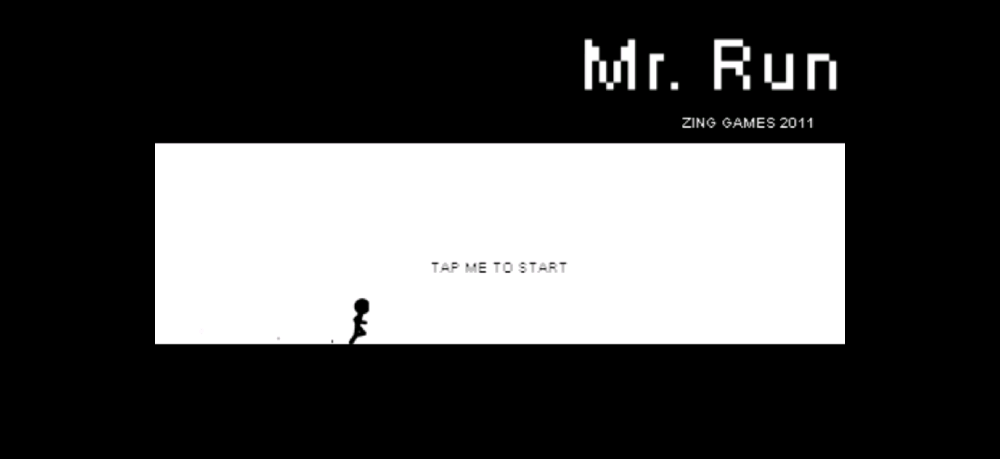

<p align="center">
  
</p>

# Respring — Mr. Runner Plus

**Mr. Runner Plus** is a classic iPhone game from 2011 that stopped working on iOS when Apple discontinued support for 32-bit apps. This project brings the original game to modern ARM64 iPhones using the [Respring](https://respring.dev/) approach and a modified [touchHLE](https://github.com/touchHLE/touchHLE) compatibility runtime.

The original ARMv6/ARMv7 executable, Lua scripts, engine, textures, and audio remain intact. A native iOS wrapper interprets the legacy ARM instructions, provides the older iOS APIs, and presents the original **480 × 320 landscape** display. **No jailbreak or JIT is required.**

## Download and install

Download **`MrRunnerPlus.ipa`** from [Releases](https://github.com/ishtiaq156/respring-mr-runner-plus/releases). This is an **unsigned ARM64 IPA**: sign it with your own sideloading tool (such as [SideStore](https://sidestore.io/) or [Sideloadly](https://sideloadly.io/)) before installing. Minimum deployment target: **iOS 15.0**.

## Status and compatibility

- **iPhone 15 Pro Max:** reported working by the owner of this port.
- **iOS Simulator:** title screen, original animation, and continuous runtime verified on an iPhone 18 Pro simulator running iOS 27.2; a 65-second run produced no new runtime panic.
- **Controls and layout:** original gameplay and touch input are retained. The game uses the classic 3.5-inch iPhone landscape aspect ratio, so black borders on newer screens are expected.
- **Online services and advertising:** iAd was discontinued by Apple; the legacy ad view is disabled. Game Center and other retired third-party services may not function.

Please use [Issues](https://github.com/ishtiaq156/respring-mr-runner-plus/issues) to report problems. Include the iOS version, device model, the screen or action involved, and (if available) `Documents/MrRunnerPlus-diagnostics.jsonl` from the app's Files container.

## How it works

Mr. Runner Plus originally targeted iPhone OS 3.0 and was built with the iOS 4.1 SDK. It combines a custom `chaos3d` game engine with Lua 5.1 scripts and OpenGL ES 1.1 graphics.

The host uses a modified 32-bit ARM/Thumb interpreter inherited from the [Respring Peggle](https://github.com/DylanMcD8/respring-peggle) project. Compatibility updates for this port include the historical `asctime` and Foundation APIs, CoreGraphics color-space functions, the old iAd view, `CADisplayLink` timestamps, OpenGL ES 1.1 point sprites and buffer handling, and audio EOF behavior. Fixing the original runtime's OpenGL buffer-ID lookup was key to rendering the title screen correctly.

See [INVESTIGATION.md](INVESTIGATION.md) for the findings, simulator diagnostics, and fixes.

## Build from source

On an Apple silicon Mac with full Xcode, CMake, Ninja, Python 3, and Rust:

```sh
rustup toolchain install 1.99.0 --profile minimal
rustup target add --toolchain 1.99.0 aarch64-apple-ios aarch64-apple-ios-sim
MRRUNNER_NATIVE_BUILD=/tmp/mrrunner-build bash Compatibility/ios/build.sh iphoneos
python3 Scripts/package_ipa.py /tmp/mrrunner-build/iphoneos/MrRunnerPlus.app \
  --output release-output/MrRunnerPlus.ipa
python3 Scripts/audit_release.py release-output/MrRunnerPlus.ipa
```

The scripts package the original game from checksum-pinned input files, build the iOS host and runtime, remove signing metadata, and verify the unsigned IPA. For simulator builds, use `iphonesimulator`. See [BUILDING.md](BUILDING.md) for prerequisites, commands, verification, and the repository layout.

## Credits and licensing

This port was created using AI coding assistance and the Respring preservation workflow. Thanks to [DylanMcD8](https://github.com/DylanMcD8) for [Respring](https://respring.dev/), [respring-peggle](https://github.com/DylanMcD8/respring-peggle), and the [restoration skill](https://github.com/DylanMcD8/respring-skill); to the [touchHLE contributors](https://github.com/touchHLE/touchHLE); and to the original creators of Mr. Runner Plus. This is an independent preservation project and is not affiliated with the game's rights holders.

The game's executable, graphics, scripts, and music are owned by their respective rights holders, including the original developer/publisher. These assets are **not** covered by the license for the compatibility code. Modified touchHLE code is under **MPL-2.0**, with additional licenses for the native host, SDL2, vendored Rust dependencies, fonts, and legacy libraries. See [LICENSE.md](LICENSE.md), [THIRD_PARTY_NOTICES.md](THIRD_PARTY_NOTICES.md), and the preserved notices in the source tree.
